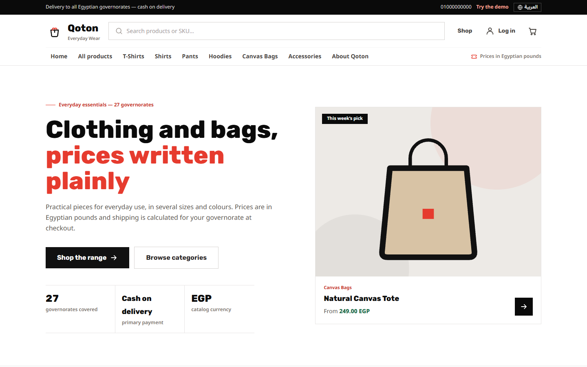
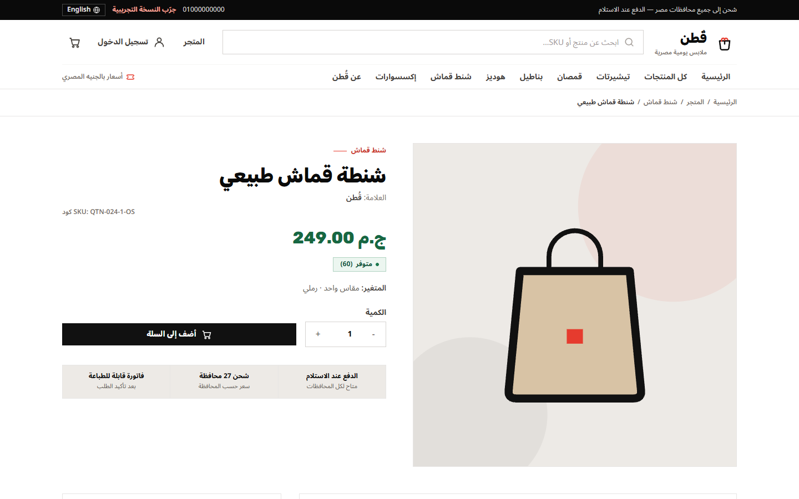
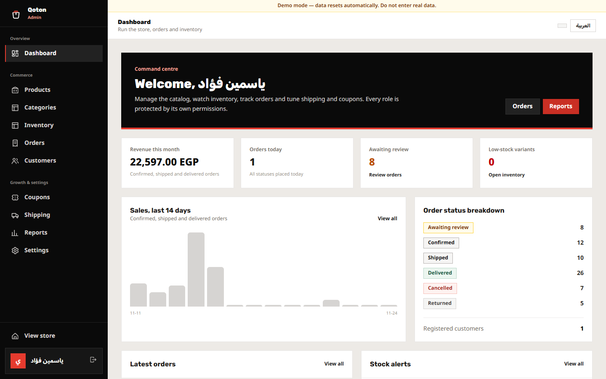
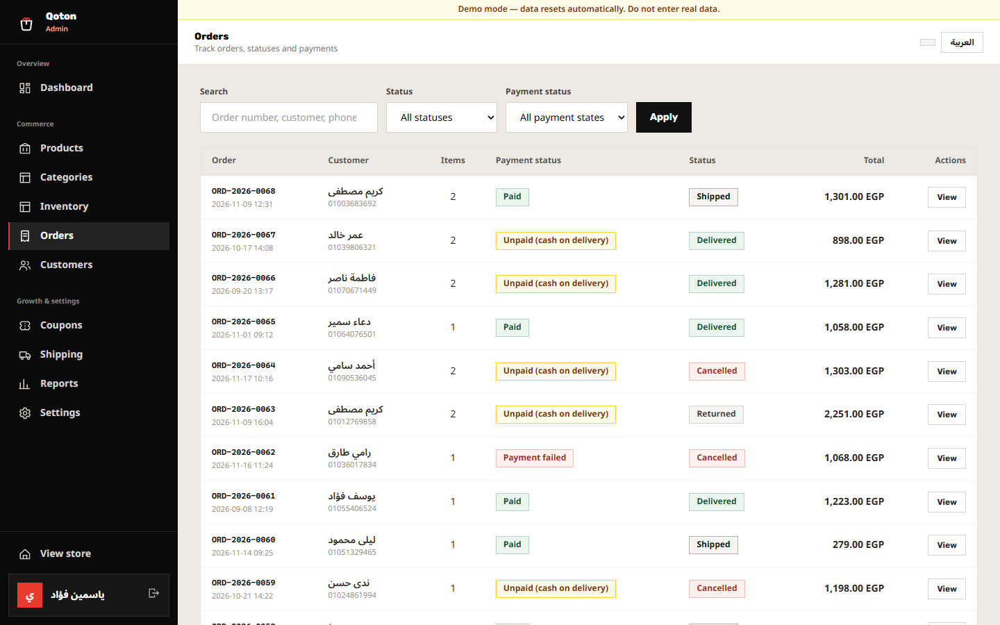
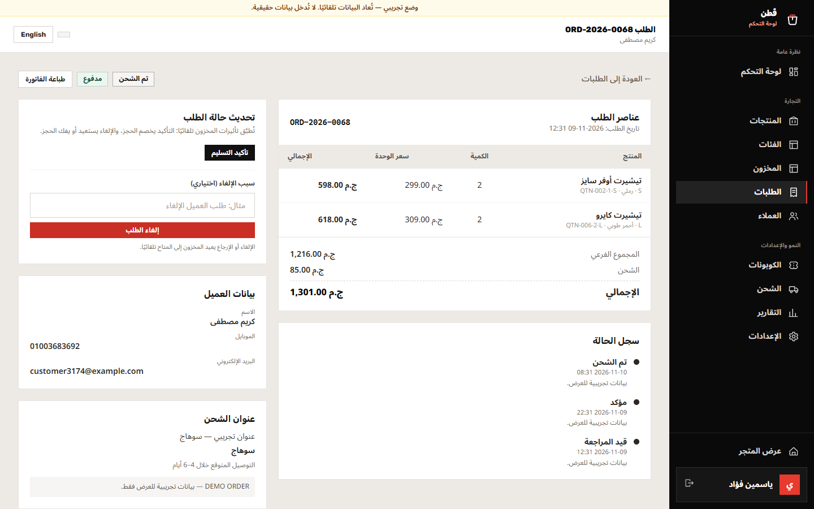
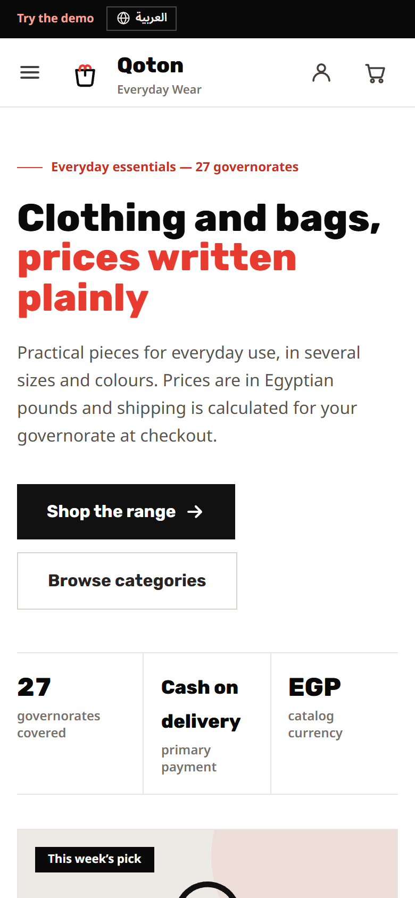
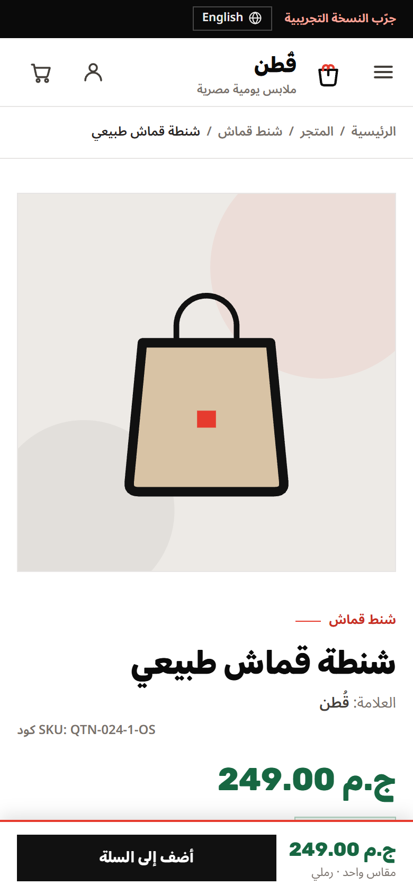
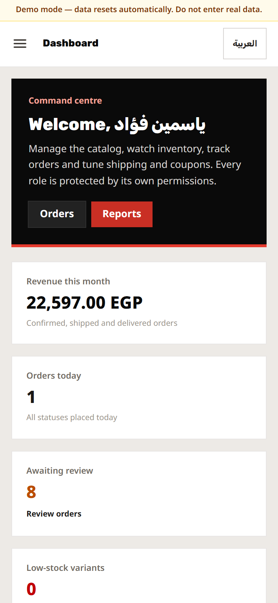

# Matjar

A complete online store for small brands: catalogue, cart, checkout, orders and an admin back office.



Matjar is an e-commerce platform built for the Egyptian market: prices in EGP, all 27 governorates with their own shipping rates, Egyptian phone validation and cash on delivery.

The demo store is **Qoton**, a fictional everyday-clothing label with 33 products, 247 size and colour variants and three months of sample orders.

The interface is Arabic-first (right-to-left) with a complete English version.

## Highlights

- **Catalogue:** categories, products with colours and S–XXL sizes, independent stock per variant, search, filters and sorting.
- **Inventory:** per-variant ledger, low-stock alerts and stock reserved inside the checkout transaction to prevent overselling.
- **Cart and coupons:** guest and customer carts, percentage and fixed coupons with limits and expiry.
- **Shipping:** rates per governorate, free-shipping thresholds and delivery windows.
- **Checkout:** cash on delivery and a local payment simulation with HMAC-signed callbacks (no real gateway is contacted).
- **Orders:** `ORD-YYYY-NNNN` numbers, full status lifecycle, stock restored on cancel or return, printable invoice.
- **Admin:** dashboard, products, inventory, orders, customers, coupons, shipping, settings and sales reports by governorate and payment method.

## Screenshots

**Product page** · Arabic



**Admin dashboard** · English



**Orders** · English



**Order detail** · Arabic



**On mobile** (English and Arabic)

<p>
  
  
  
</p>

## Tech stack

| Layer | Technology |
| --- | --- |
| Backend | PHP 8.4, Laravel 13 |
| Frontend | Blade, Tailwind CSS 4, Alpine.js 3 (CSP build), Vite 8 |
| Database | SQLite |
| Fonts | Rubik and Noto Sans Arabic, self-hosted |
| Tests | Pest / PHPUnit |

No CDNs, trackers or analytics. All fonts and assets are self-hosted.

## Running locally

Requirements: PHP 8.3+ with the `pdo_sqlite`, `sqlite3`, `mbstring`, `fileinfo` and `zip` extensions, Composer 2, Node.js 24 and npm.

```bash
composer install
cp .env.example .env
php artisan key:generate
touch database/database.sqlite
php artisan migrate --seed
php artisan storage:link
npm install
npm run build
php artisan serve
```

Then open http://127.0.0.1:8000 (admin at `/admin`).

Full setup notes are in [INSTALL.md](INSTALL.md).

## Demo access

Open `/demo` to enter instantly as Admin, Staff or Customer. Store data resets every hour (`php artisan demo:reset --force`). Set `DEMO_MODE=false` in `.env` to remove the demo entry points.

All names, phone numbers, emails and records in the demo are fictional sample data.

## Tests

```bash
php artisan test
```

168 automated tests, all passing at the time of publishing. Details in [TESTING.md](TESTING.md).

## Documentation

- [INSTALL.md](INSTALL.md)
- [TESTING.md](TESTING.md)
- [SECURITY.md](SECURITY.md)
- [ROADMAP.md](ROADMAP.md)
- [docs/ARCHITECTURE.md](docs/ARCHITECTURE.md)
- [docs/DECISIONS.md](docs/DECISIONS.md)
- [THIRD-PARTY-NOTICES.md](THIRD-PARTY-NOTICES.md)

## License

Copyright © 2026 Fedaa Mohamed. All rights reserved.

This repository is public so the code can be reviewed. It is **not open source**: no permission is granted to use, copy, modify, distribute or sell any part of it without prior written permission. See [LICENSE](LICENSE). Third-party libraries and fonts keep their own licences, listed in [THIRD-PARTY-NOTICES.md](THIRD-PARTY-NOTICES.md).

---

Designed & built by [Fedaa Mohamed](https://fedaamohamed.com).
